<div align="center">


# KommaKorrektus

**The editing studio and back office for freelance manuscript editors — in one container.**

Correct a text and see exactly what changed. Track the time you worked, send the author a link, issue a
proper e-invoice, and back everything up to your NAS. Self-hosted, German interface, no cloud.

</div>

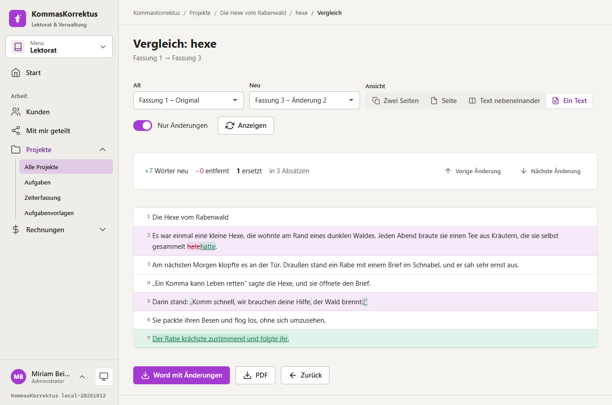

---

## What this is about

A manuscript editor's day is split between three tools that do not know each other: Word with tracked changes for the
text, a spreadsheet for the hours, and an invoice template for the money. KommaKorrektus puts them in one place:

- **The text**: import a Word, PDF or text file, correct it in a paragraph editor, and every save is a **version**.
  Old and new can be compared next to each other or as one document, and exported as **Word with tracked changes**
  that the author accepts or rejects in Word.
- **The time**: the editor knows when you typed, how many words you corrected and where you paused. The hours of a
  project fill themselves in, and can be put on an invoice with one click.
- **The money**: customers and their history, projects, offers and invoices with your logo and wording, a live PDF
  preview, and **ZUGFeRD / XRechnung** e-invoices that validate against the EN 16931 schema.
- **The author**: an **anonymous link** (with expiry and optional password) shows a project or one version, with the
  changes, remarks and a "looks good" button. Or give the author an account with access to their projects.

It runs as one ASP.NET Core container with a PostgreSQL next to it, keeps its settings in one JSON file, and stores
documents in a volume or on a NAS (SMB).

## At a glance

**Text and versions**
- Import **DOCX** (formatting kept), **PDF** (paragraphs reconstructed) and **text**; paragraph-by-paragraph editor with
  autosave, undo, find and replace, remarks per paragraph and a style sheet (names, spellings, terms) per project
- **Every save is a version**; an autosave of the same person updates the previous autosave, a manual save promotes it:
  one working session leaves one version, not twenty. Restoring an old version creates a new one
- **Comparison** at word level: side by side or as one text, only the changes (with a paragraph of context) or
  everything, jump from change to change (`n` / `p`)
- Export: **DOCX with tracked changes** (in the original file, formatting untouched), clean DOCX, PDF proof sheet
  (struck-through / underlined), PDF side by side, plain text

**Time**
- Working time recorded from the editor: blocks start with the first keystroke and end after a pause (5 minutes, adjustable);
  words added, changed and removed are counted per block
- Manual entries (`1:30`, `90 min`, `1,5 Stunden`), a running timer, billable or not, and one click to put the
  unbilled hours on an invoice

**Customers, projects, tasks**
- Customers (people, publishers) with pen name, contacts, notes and a **history** of calls, mails, invoices and links
- Projects with status, deadline, rate per standard page / word / hour or a flat price, tasks (from templates),
  documents, time, invoices and share links on one page

**Offers and invoices**
- Products and text blocks with placeholders (`{{Anrede}}`, `{{Projekt}}`), templates with logo, colours and layout,
  a **live PDF preview** while you type
- Numbers are assigned only when a document is issued: **no gaps**, restarting each year. Issued documents are frozen
  (a snapshot is kept); corrections are a **credit note**. Partial payments, overdue status, offers become invoices
- **ZUGFeRD (PDF/A-3 with `factur-x.xml`)** and **XRechnung** (CII XML), small-business rule (§ 19 UStG), reverse charge,
  GiroCode (EPC QR) on the invoice

**Sharing and accounts**
- **Anonymous links** to a project or one version: expiry, optional password (checked once, remembered for 4 hours),
  allow or forbid changes / downloads / remarks / approval, access log, take back at any time
- **Invitations**: a link that works once; the person registers with a password or signs in with an **e-mail code**
  from then on, and sees only the customer they were invited for (the **client portal**)
- Roles **Administrator**, **Lektorat** (user) and **Client**; **TOTP** (authenticator app) with recovery codes,
  lock-out after repeated wrong passwords; sessions are kept in the database and survive a restart

**Operations**
- **NAS**: documents and generated files can live on an SMB share (move them over and back with one click)
- **Backup**: plans (hourly, daily, weekly, monthly) to a folder or an SMB share, *system only* or *system and files*,
  retention (newest N, one per day / week / month), optional encryption (AES-256-GCM), restore with a safety copy
- Administration: users, invitations, mail server (with test), storage, security, company data, activity log, mail log
- Dark / light / system theme, phone-friendly, scrollbars only while scrolling

## Screenshots

| | |
|---|---|
| 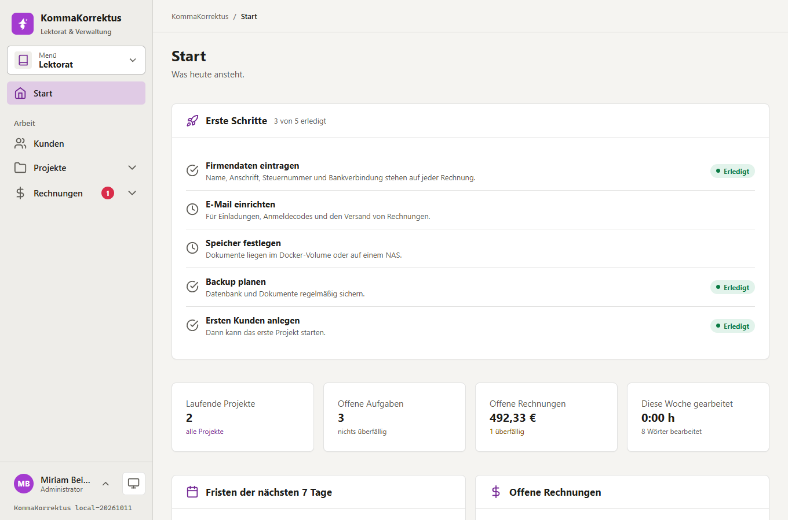 **Start**: open projects, tasks, invoices, deadlines | 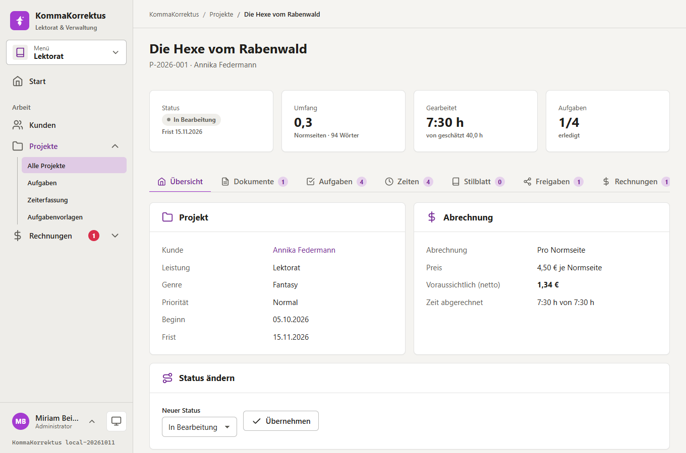 **A project**: status, work done, tasks, documents, links |
| 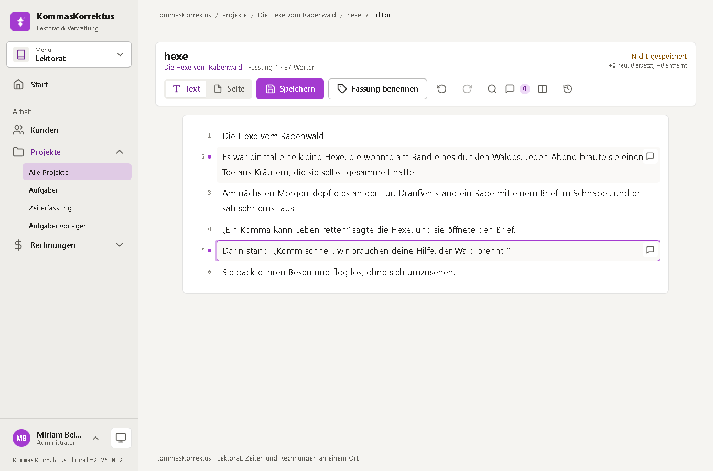 **Editor**: paragraph by paragraph, saved as versions | 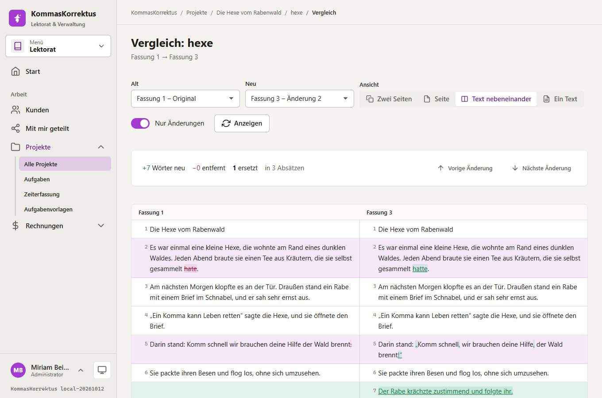 **Comparison**: old and new next to each other |
| 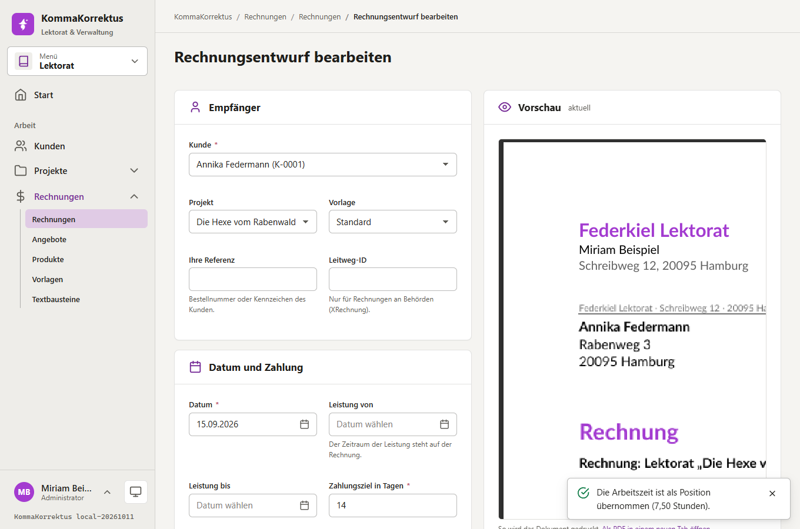 **Invoice**: live PDF preview next to the form | 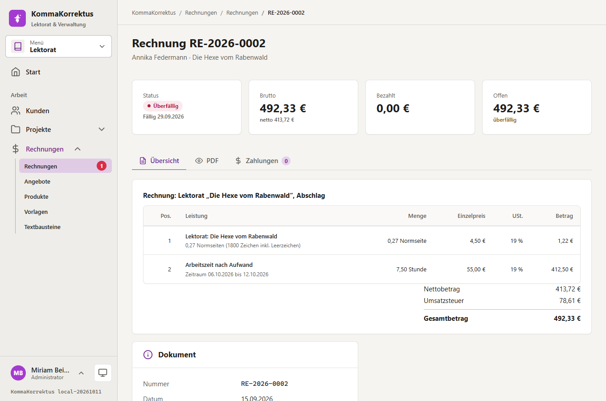 **Issued**: frozen, with payments and e-invoice |
| 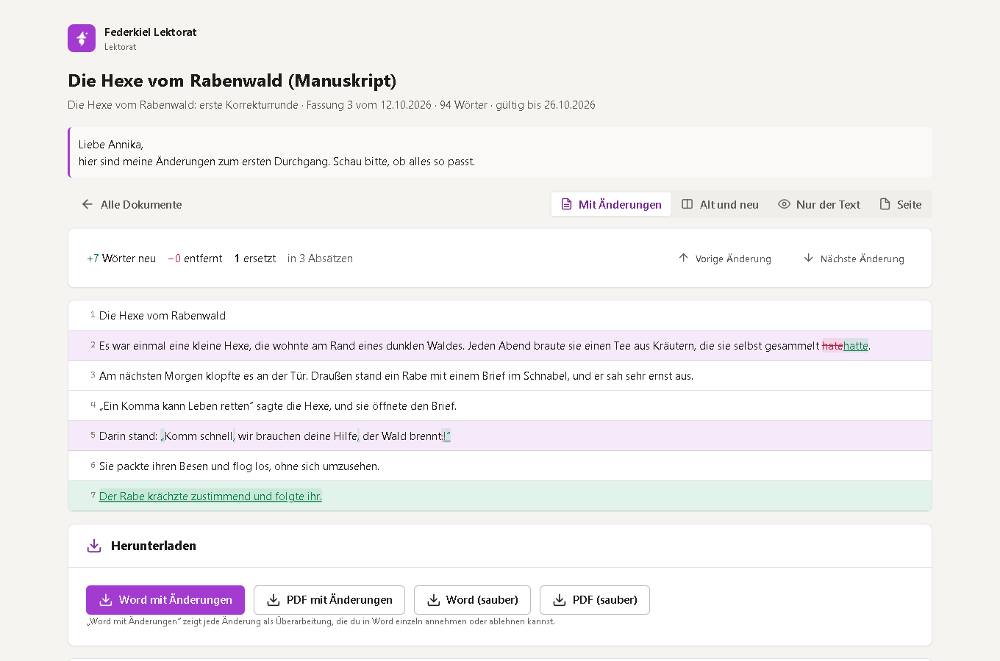 **Share link**: changes, downloads, remarks, approval | 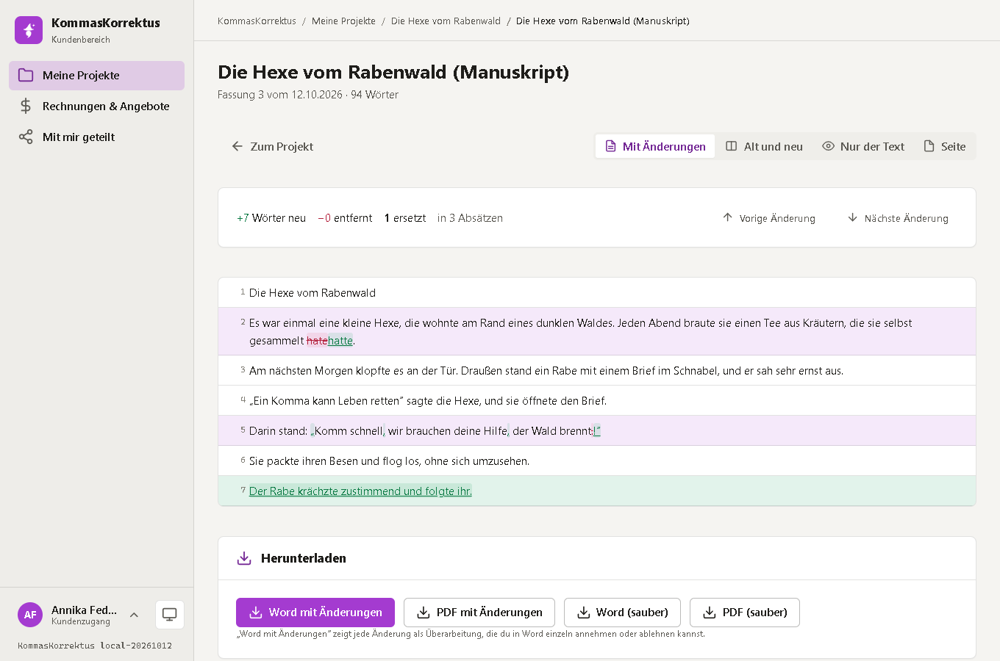 **Client portal**: only the customer's own projects |
| 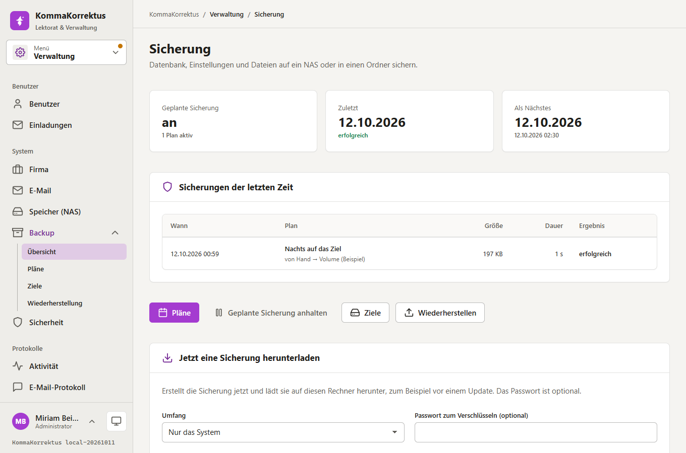 **Backup**: plans, targets, restore | 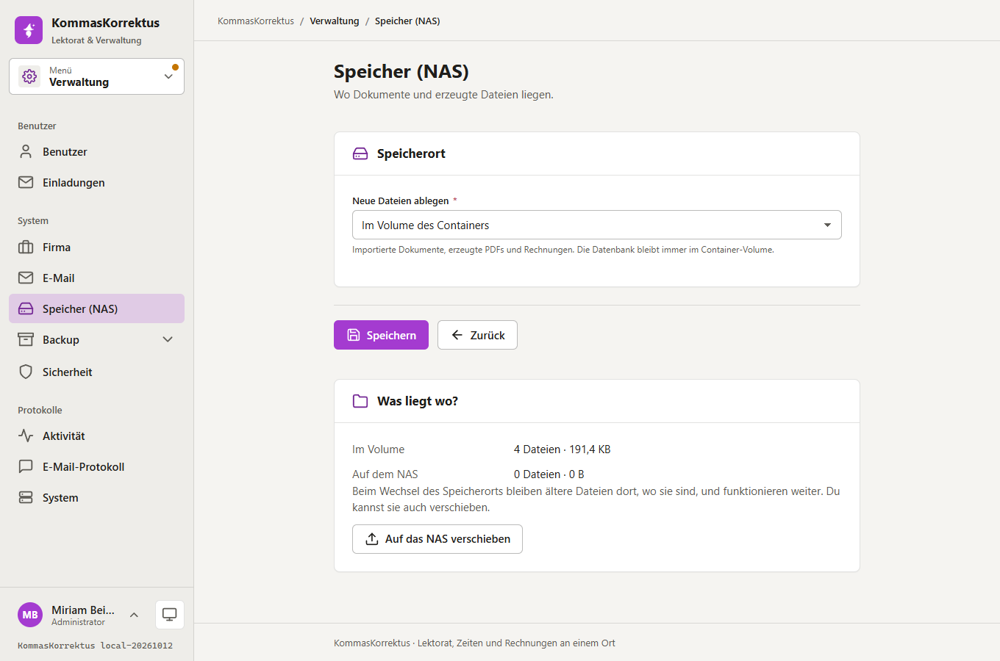 **NAS**: documents on an SMB share |

On a phone and in dark mode:

| | | | |
|---|---|---|---|
| 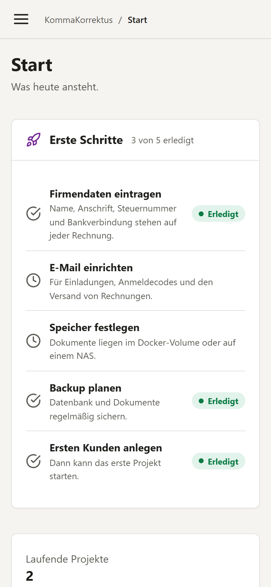 | 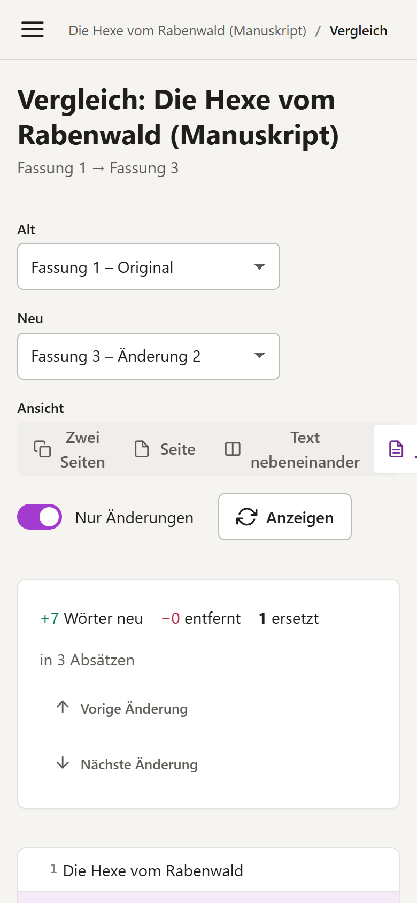 | 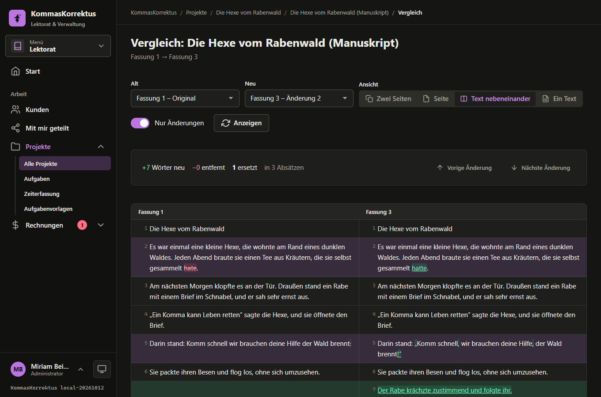 | 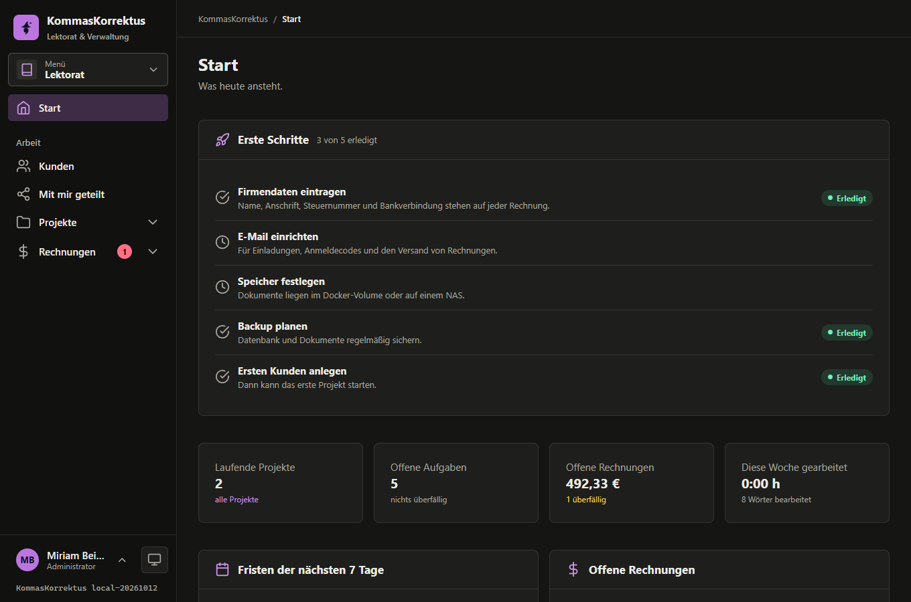 |

More: [docs/FEATURES.md](docs/FEATURES.md) lists everything, area by area.

## Quick start

You need Docker with Compose. The release stack is one app and one database:

```bash
curl -O https://raw.githubusercontent.com/Real-TTX/KommasKorrektus/main/docker-compose.yml
docker compose up -d
```

Open <http://localhost:2930>. The first visit shows the **setup page**: choose a name, an e-mail address and a password
for the administrator. Then the start page walks you through the rest:

1. **Firma** (Verwaltung → Firma): name, address, tax number, bank account: they stand on every invoice
2. **E-Mail** (Verwaltung → E-Mail): needed for invitations, codes and sending invoices (test the connection there)
3. **Speicher**: documents in the volume (default) or on a NAS
4. **Backup**: a target and a plan (see below)
5. Your first customer and project

> The container speaks plain HTTP on port **2930**. Put a reverse proxy with TLS in front of it
> (Caddy, nginx, Traefik) and set the public address under *Verwaltung → Sicherheit*, so that links in mails are right.

### Volumes

| Volume | Holds |
|---|---|
| `kommakorrektus-data` → `/data` | `config/app.json` (settings), `keys/` (the key ring that protects cookies and stored passwords), `files/` (documents, if stored in the volume), `backups/` (a local target), `tmp/` |
| `kommakorrektus-db` | the PostgreSQL data |

### Environment variables

Everything a person sets up is on the administration pages. These belong to the deployment and win over the file:

| Variable | Default | |
|---|---|---|
| `KOMMAKORREKTUS_DATA` | `/data` | the data folder |
| `KOMMAKORREKTUS_PORT` | `2930` | the port inside the container |
| `KOMMAKORREKTUS__Database__Host` / `Port` / `Database` / `Username` / `Password` | `db` / `5432` / `kommakorrektus` / `postgres` / `kommakorrektus` | the database |
| `KOMMAKORREKTUS__Server__PublicUrl` | from the request | the address in links in mails |
| `KOMMAKORREKTUS__Server__TimeZone` | `Europe/Berlin` | dates, schedules and numbering |
| `KOMMAKORREKTUS__Server__ForceSecureCookie` | `false` | mark the cookie `Secure` behind a TLS proxy |

**Change the database password** before you expose anything: set `POSTGRES_PASSWORD` for the `db` service and
`KOMMAKORREKTUS__Database__Password` for the app to the same value.

## Backup and restore

*Verwaltung → Sicherung*:

1. **Ziele**: where backups go. A folder (relative to the data volume, or an absolute path of a mounted drive) or a
   **share on a NAS** (SMB 2.0.2 – 3.0.2 on port 445; "Prüfen" writes and removes a small file to show that it works)
2. **Pläne**: what, where to, when. *Nur das System* is the database and the settings (small and fast);
   *System und Dateien* adds every uploaded document and generated PDF. For example: keep the newest 7, plus one per week for
   4 weeks, plus one per month for 6 months (the rules add up). A password encrypts the file
3. **Wiederherstellen**: pick a backup from a target or upload a file. The page shows what is inside, asks for the word
   `WIEDERHERSTELLEN`, saves the current state as a safety copy (the newest three are kept) and replaces the database in
   **one transaction**: either everything is back or nothing changed

A backup contains the key ring of the application (to read the stored passwords again): **encrypt it** when the target
is not yours alone. *Jetzt eine Sicherung herunterladen* makes one on demand, for example before an update.

## Roles and access

| Role | Can |
|---|---|
| **Administrator** | everything, including users, invitations, mail, storage, backup |
| **Lektorat** (user) | customers, projects, documents, time, offers and invoices |
| **Client** | the portal: the projects, documents (with changes), remarks and invoices of the customers it was invited for |
| *Anonymous* (link) | what the link allows, until it expires |

A page a client or visitor may not see answers *not found*, so that other records are not revealed.

## Development

```powershell
./scripts/redeploy.ps1          # rebuild the image and redeploy the dev stack (http://localhost:2930, pgAdmin on 2931)
./scripts/redeploy.ps1 -Fresh   # the same with empty volumes (the setup page appears again)
dotnet test KommaKorrektus.slnx
```

Tests: unit tests need nothing. **Integration tests** run the real application against PostgreSQL and, for the NAS,
a Samba server; they skip themselves when the variables are missing:

```bash
docker run -d -p 55432:5432 -e POSTGRES_PASSWORD=kommakorrektus postgres:17
export KOMMAKORREKTUS_TEST_DB="Host=localhost;Port=55432;Username=postgres;Password=kommakorrektus"
export KOMMAKORREKTUS_TEST_SMB="localhost;share=backups;user=backup;password=backup-secret"   # optional
dotnet test KommaKorrektus.slnx
```

Branches: **`main`** is the release, **`dev`** is development. The GitHub Action builds and tests on every push and pull
request and pushes the image to `ghcr.io/real-ttx/kommaskorrektus`:

| Branch | Version | Tags |
|---|---|---|
| `main` | `<major>.<minor>.<build>-<date>` e.g. `1.0.42-20261007` | version, `latest`, `release` |
| `dev` | `nightly-<build>-<date>` | version, `nightly` |
| local | `local-<date>` | — |

### Structure

```
src/KommaKorrektus.Core/   diff engine, DOCX / PDF reading and writing, invoice maths, e-invoice (no web dependencies)
src/KommaKorrektus/        the web application
  Pages/                   Razor Pages: one folder per area (Customers, Projects, Documents, Invoices, Admin, Portal, Share ...)
  Services/                business logic (documents, time, billing, sharing, backup, sign-in)
  Controls/                tag helpers: kk-input, kk-select, kk-tabs, kk-card, kk-buttons ... (one code base for every form)
  UiKit/                   table, toolbar, pager and shell models
  Data/                    EF Core model and migrations (PostgreSQL, PascalCase, audit columns)
  Storage/                 volume and SMB file stores
tests/                     unit and integration tests
```

The interface is built on the MatDesign toolkit (copied into `wwwroot/ui`, purple accent). Lists share one toolbar,
table and pager; forms share the field controls; there are no inline scripts or styles (a strict CSP is set).

## Good to know

- **PDF import** works on text PDFs: paragraphs are rebuilt from line spacing, which is a heuristic. Check the result
  before you start correcting. Scanned PDFs (images) contain no text to read.
- **Word with tracked changes** is written into the *original* file when there is one, so styles, headers and
  footnotes stay as they are. Text-only imports get a plain document.
- **SMB** is tried against SMB 2.0.2 – 3.0.2; a server that offers only SMB 1 or only 3.1.1 cannot be used.
- The e-invoice XML is checked against the official EN 16931 schema (in the tests), and the ZUGFeRD PDFs pass **veraPDF**
  as PDF/A-3b (146 rules, none failed). Offers are plain PDFs: there is no e-invoice for an offer.

Test fixtures contain the EN 16931 CII schema from the CEN / ConnectingEurope repository (EUPL 1.2).
